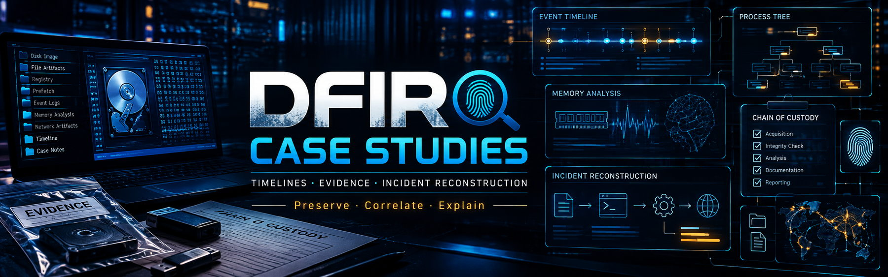
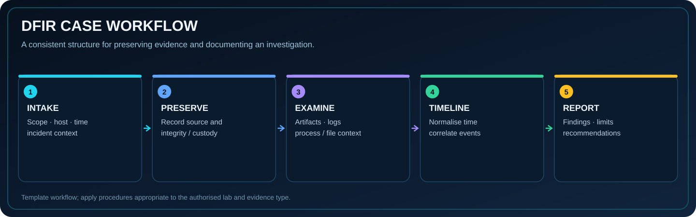

**Preserve · Correlate · Explain**

## 🔎 Purpose

A workspace for structured digital forensics and incident response write-ups. Each case is designed to show the investigation question, evidence provenance, event timeline, findings, uncertainties and recommended next actions.

## 🧭 Case-study structure

1. **Scope and context** — what was reported, systems involved and time window.
2. **Evidence register** — source, timestamp, hash or integrity information where available.
3. **Timeline** — normalised timestamps and source attribution.
4. **Analysis** — what each artifact establishes and how sources correlate.
5. **Findings** — confirmed, inferred and unresolved points.
6. **Response** — containment, preservation and follow-up recommendations.

## 📂 Start here

- [Case study template](CASE-STUDY-TEMPLATE.md) — reusable structure for future cases.
- [SOC-2047 timeline in SOC Notes](https://github.com/RAFI131/soc-notes/blob/main/day7-soc-2047.md) — related simulated SOC case used for investigation practice.

## 🧪 Evidence standard

Use authorised or synthetic data. Keep original evidence distinct from analyst notes, record time zones, preserve source references, and do not present a hypothesis as a finding without corroboration. Case studies are added when the supporting work and evidence can be described accurately.

## 🗺️ Planned case workflow

- Endpoint process and file-artifact timeline
- Windows event correlation
- Evidence-handling and integrity notes
- Root-cause reasoning and containment decision log

---

**Reconstruct the event. Show the evidence. State the limits.**

